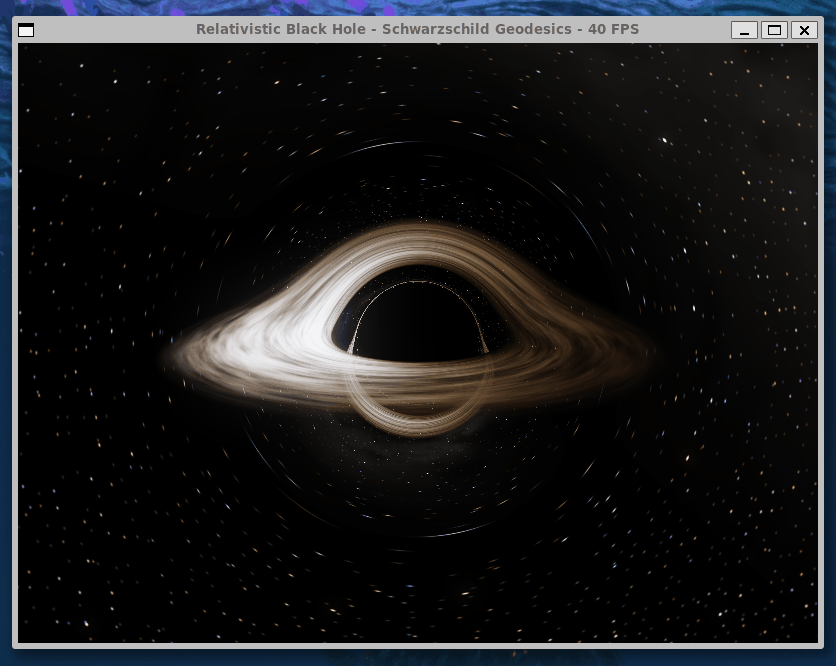
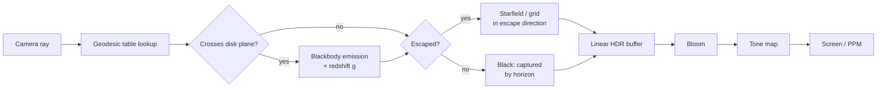

<div align="center">

# Blackhole Simulation

**A real-time, physically based ray tracer for a Schwarzschild black hole, written in C++17.**

Light is traced along exact general-relativistic geodesics, and a blackbody accretion disk is rendered with Doppler beaming and gravitational redshift, interactively on the CPU.

[](https://en.cppreference.com/w/cpp/17)
[](https://www.libsdl.org/)
[](https://www.openmp.org/)
[](LICENSE)



</div>

---

## Features

| Feature | Description |
|---|---|
| **Exact light bending** | Photons follow the Schwarzschild orbit equation, not an approximation. You see the Einstein ring, the photon ring and the far side of the disk lensed over the top of the hole. |
| **Blackbody accretion disk** | Thin Novikov–Thorne disk from the ISCO (6M) outwards. Gas colour comes from Planck's law integrated against the CIE 1931 colour-matching functions. |
| **Relativistic shifts** | Doppler beaming, time dilation and gravitational redshift together make the approaching side of the disk brighter and bluer than the receding side. |
| **Procedural starfield** | Hash-noise stars of varied colour and brightness, plus a faint galactic band, all lensed around the hole. |
| **Lensing grid mode** | Replaces the sky with a checkerboard to visualise how spacetime distorts the background. |
| **HDR, bloom & tone mapping** | Renders in linear HDR, adds a two-scale bloom from a quarter-res buffer, then tone-maps to the screen. |
| **Real-time on the CPU** | A precomputed geodesic lookup table plus OpenMP across scanlines keep it interactive without a GPU. |
| **Headless screenshots** | Render a supersampled still to a `.ppm` without opening a window. |

---

## Getting started

### Requirements

- A C++17 compiler with OpenMP (GCC is the default in the Makefile)
- SDL2 development headers
- `make`

<details>
<summary><b>Installing dependencies</b></summary>

```bash
# Debian / Ubuntu / WSL
sudo apt install build-essential libsdl2-dev

# Fedora
sudo dnf install gcc-c++ make SDL2-devel

# Arch
sudo pacman -S base-devel sdl2

# macOS (Homebrew GCC for OpenMP)
brew install gcc sdl2
make CXX=g++-14
```

</details>

### Build and run

```bash
git clone https://github.com/JackMagee21/Blackhole-Simulation.git
cd Blackhole-Simulation
make run
```

| Command | What it does |
|---|---|
| `make` | Optimised build (`-O3 -march=native -ffast-math`) → `./sim` |
| `make run` | Build and launch |
| `make debug` | Build with debug symbols |
| `make clean` | Remove build output |

### Screenshot mode

```bash
./sim --screenshot render.ppm 12   # render the scene 12 seconds in, 3x3 supersampled
```

---

## Controls

| Input | Action |
|---|---|
| **Left drag** | Orbit the camera |
| **Scroll** | Zoom in / out |
| <kbd>R</kbd> | Toggle automatic camera orbit |
| <kbd>Space</kbd> | Pause / resume time |
| <kbd>D</kbd> | Toggle accretion disk |
| <kbd>G</kbd> | Toggle checkerboard sky (shows lensing distortion) |
| <kbd>B</kbd> | Toggle bloom |
| <kbd>A</kbd> | Toggle 2×2 anti-aliasing (4× slower) |
| <kbd>-</kbd> / <kbd>=</kbd> | Exposure down / up |
| <kbd>Esc</kbd> | Quit |

The current frame rate is shown in the window title.

---

## The physics

Everything uses geometric units ($G = c = 1$), so every distance is a multiple of the black hole's mass $M$.

| Radius | Meaning |
|---|---|
| $r = 2M$ | **Event horizon**: nothing inside escapes |
| $r = 3M$ | **Photon sphere**: light can orbit here, unstably; it sets the edge of the shadow |
| $r = 6M$ | **ISCO**: innermost stable circular orbit, where the disk's inner edge sits |
| $b = 3\sqrt{3}\,M$ | **Critical impact parameter**: photons aimed closer than this are captured |

### Light paths

Because Schwarzschild spacetime is spherically symmetric, every photon stays in a single plane. Writing $u = 1/r$, its path through that plane obeys

$$\frac{d^2u}{d\phi^2} = 3Mu^2 - u$$

The shape of the path depends only on the angle $\alpha$ between the ray and the direction to the hole. So instead of integrating millions of rays per frame, the renderer integrates this equation once for a few thousand values of $\alpha$, stores the results in a **geodesic table**, and has each pixel interpolate its path from it. The table is rebuilt only when the camera's distance from the hole changes.

### Disk colour

Gas orbits at the Keplerian angular velocity $\Omega = \sqrt{M / r^3}$. Light reaching the camera from radius $r$ is shifted in frequency by

$$g = \frac{\nu_\text{obs}}{\nu_\text{emit}} = \frac{\sqrt{1 - 3M/r}}{\sqrt{1 - 2M/r_\text{obs}}\,\left(1 - \Omega\,\lambda_z\right)}$$

where $\lambda_z$ is the photon's angular momentum about the disk axis. This one factor combines gravitational redshift, time dilation and the Doppler shift. The disk's temperature follows the thin-disk profile (zero at the ISCO, peaking just outside it, falling off as $r^{-3/4}$), and is then shifted by $g$ before being turned into a colour with Planck's law.

### Render pipeline



---

## Project structure

```
src/
├── Main.cpp                 Entry point, input handling, main loop
├── Math/                    Vec3, Ray, hash-based value noise
├── Physics/
│   ├── Schwarzschild.h      Closed-form radii, orbit equation, frequency shift
│   └── GeodesicTable.*      Precomputed photon paths
├── Render/
│   ├── Renderer.*           Per-pixel shading and the frame loop (OpenMP)
│   ├── Blackbody.*          Planck's law → linear sRGB
│   ├── Bloom.*              Two-scale glow on a quarter-res buffer
│   ├── Colour.h             HDR colour and tone mapping
│   ├── Image.h              CPU image with PPM output
│   └── PixelBuffer.*        SDL streaming texture
├── Scene/
│   ├── SceneConfig.h        Every tunable setting in one place
│   ├── AccretionDisk.*      Thin disk with animated turbulence
│   ├── Camera.* / CameraOrbit.*
│   ├── Starfield.*          Procedural stars and galactic band
│   └── CelestialSphere.*    Checkerboard sky
└── Platform/Window.*        SDL window and input
```

## Configuration

All scene parameters live in [`src/Scene/SceneConfig.h`](src/Scene/SceneConfig.h): resolution, field of view, black hole mass, orbit distance, disk radii, peak disk temperature, time scale and exposure. Distances are given as multiples of $M$, so changing the mass scales the hole without changing the view.

---

## License

Released under the [MIT License](LICENSE).

<div align="center">
<sub>Built with C++17, SDL2 and OpenMP.</sub>
</div>
